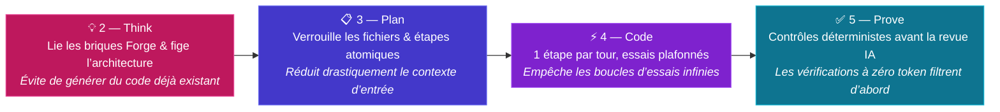

# 💰 Gestion des coûts

L’usage ad hoc de l’IA brûle des tokens de manière invisible : les développeurs collent des fichiers entiers dans le chat, utilisent des modèles de pointe (*frontier models*) pour des modifications triviales et laissent les agents tourner en boucle lors des tentatives de correction. À la fin du mois, l’organisation reçoit une facture unique sans lien avec ce qui a été livré.

L’Agentic Software Factory transforme la dépense IA en un **coût unitaire gouverné et attribuable par résultat livré**.

## Pourquoi l’usine réduit la consommation de tokens

| Usage ad hoc de l’IA | L’Agentic Software Factory |
|---|---|
| Modèle de pointe utilisé pour chaque chat et autocomplétion | **Modèle dimensionné par étape** selon la charge cognitive de chaque tâche |
| Prompt vague envoyé directement à un agent de code | **Entonnoir en 3 étapes Think → Plan → Code** qui réduit le périmètre avant toute génération |
| Dépôt entier injecté dans la fenêtre de contexte | **Périmètre de fichiers explicite** dans Plan et instructions finement ciblées dans le Contexte persistant |
| Les agents réessaient indéfiniment quand les vérifications échouent | **Plafond strict de tentatives** qui stoppe la dérive et escalade au développeur |
| Les équipes régénèrent chaufferie, authentification et squelettes | **[La Forge](./forge)** lie des briques pré-construites et testées pour zéro token de génération |
| L’IA est sollicitée pour détecter les erreurs de syntaxe ou de typage | **[Les Contrôles déterministes](./deterministic-controls)** détectent les erreurs en amont pour zéro token |
| Facture API mensuelle globale non ventilée | **Attribution par ticket, par étape et par squad** reliée aux résultats métier |

## Sélection optimisée des modèles par étape

Toutes les tâches ne nécessitent pas un modèle de raisonnement de pointe. Chaque primitive d’agent dans le [Contexte persistant](./persistent-context) déclare le niveau de modèle adapté à sa mission :

| Étape | Tâche cognitive | Niveau de modèle | Pourquoi cela optimise les coûts |
|---|---|---|---|
| **[0 — Meet](./stage-meet)** & **[1 — Triage](./stage-triage)** | Structuration de transcription, extraction de citations, qualification du backlog | Modèles rapides et économiques d’extraction et de classification | Le traitement de texte à fort volume s’exécute sur des modèles légers à une fraction du prix des modèles de pointe |
| **[2 — Think](./stage-think)** | Arbitrage d’options, découverte dans la [Forge](./forge), rayon d’impact | Modèle de pointe à fort raisonnement (*frontier*) | Concentre la dépense de raisonnement là où un bon choix architectural économise des dizaines de milliers de tokens de code |
| **[3 — Plan](./stage-plan)** | Découpage en étapes atomiques, périmètre de fichiers, critères testables | Modèle de raisonnement structuré | Convertit l’architecture en une liste de contrôle bornée une seule fois, au lieu de re-raisonner à chaque tour de code |
| **[4 — Code](./stage-code)** | Implémentation d’une étape atomique et diffs chirurgicaux | Modèle de code rapide et économique | Les décisions d’architecture sont déjà tranchées dans Think et Plan ; Code exécute de petites étapes déterministes |
| **[5 — Prove](./stage-prove)** | Jalons CI propres, revue de diff indépendante, auto-remédiation ciblée | Contrôles déterministes à zéro token d’abord ; modèle de revue/correction uniquement sur le diff | Compilateurs, linters et tests coûtent zéro token ; l’agent Prove n’analyse que les changements qui passent la CI |
| **[7 — Learn](./stage-learn)** | Synthèse de télémétrie, verdict de résultat, propositions de contexte | Modèle analytique léger | Synthétise des signaux de production structurés sans génération lourde |

## Optimisation du workflow : l’entonnoir en 3 étapes Think → Plan → Code

Envoyer une demande de fonctionnalité brute directement à un agent de code est la principale source de gaspillage de tokens : l’agent parcourt des fichiers hors sujet, devine l’architecture, casse les contrats existants et brûle des tokens en essayant de réparer ses propres erreurs.

La séquence **Think → Plan → Code** agit comme un entonnoir à tokens :

1. **[2 — Think](./stage-think) élimine la génération redondante.** Avant de planifier, l’agent Thinker interroge [la Forge](./forge) et lie les services, bibliothèques et modèles existants. Le code le moins cher est celui que l’on ne paie jamais un agent à générer ou à déboguer.
2. **[3 — Plan](./stage-plan) réduit le volume de tokens en entrée.** Plan définit le **périmètre exact des fichiers** — quels fichiers l’agent de code peut lire et modifier, et lesquels sont interdits — et découpe le changement en étapes atomiques. Au lieu d’injecter tout le dépôt à chaque tour, l’agent ne charge que les fichiers de l’étape en cours.
3. **[4 — Code](./stage-code) borne les tokens en sortie et les boucles d’essais.** L’agent de code applique des modifications chirurgicales (standard `sharp-agent`) pour une seule étape à la fois et exécute sa commande de vérification. Un plafond strict de tentatives stoppe l’exécution lorsqu’une étape ne parvient pas à s’auto-corriger, escaladant au développeur au lieu de brûler des tokens en boucle.

## Empêcher le gaspillage de tokens et les mauvais usages de l’IA

Sans garde-fous structurels, les équipes gaspillent des tokens de manière prévisible. L’usine bloque chacun de ces travers par conception :

| Mauvais usage fréquent | Pourquoi cela gaspille des tokens | Comment l’usine l’empêche |
|---|---|---|
| **Tâtonnement conversationnel** (*vibe coding* dans le chat) | Les longs échanges renvoient l’intégralité de l’historique de conversation à chaque message | Le travail s’exécute via des pipelines d’étapes à partir de spécifications commitées (`think.md`, `plan.md`), pas de sessions de chat ouvertes |
| **Répétition des conventions dans les prompts** | Chaque développeur rédige des paragraphes pour rappeler les mêmes règles à chaque tour | Les conventions sont consignées une seule fois dans le [Contexte persistant](./persistent-context) et versionnées dans Git |
| **Chargement de contexte non borné** | Injecter un fichier d’instructions global massif à chaque requête taxe chaque appel au modèle | Les instructions sont courtes et ciblées sur des motifs de fichiers précis |
| **Génération monolithique en une seule passe** | Demander une fonctionnalité entière d’un coup produit une sortie tronquée ou cassée qu’il faut régénérer de zéro | [Code](./stage-code) impose **une étape atomique par tour**, vérifiée avant de passer à la suivante |
| **Utiliser les LLM comme compilateurs ou linters** | Payer des tokens de raisonnement pour trouver des imports manquants, des erreurs de syntaxe ou de typage | Les [Contrôles déterministes](./deterministic-controls) et les scripts de build/typage/lint s’exécutent d’abord pour zéro token |
| **Corriger deux fois la même erreur d’agent** | Corriger un problème dans une session de chat laisse la squad suivante brûler des tokens sur le même piège | Les correctifs de fond enrichissent le [Contexte persistant](./persistent-context) lors de [7 — Learn](./stage-learn), supprimant la dépense répétée pour toutes les squads |

## Attribution des tokens et ROI

Parce que chaque exécution d’agent est déclenchée depuis la [plateforme Git unifiée](./tooling) et reliée à un ticket, une branche et une pull request, **100 % de la consommation de tokens est attribuée**.

### Savoir exactement à quoi ont servi vos tokens

Chaque appel au modèle enregistre le volume de tokens et le coût associé selon quatre axes :

| Niveau d’attribution | Question à laquelle il répond |
|---|---|
| **Par élément de travail** | Combien ce ticket de backlog a-t-il consommé de [0 — Meet](./stage-meet) à [6 — Release](./stage-release) ? |
| **Par étape** | Les tokens ont-ils été consommés pour la conception (Think/Plan), l’implémentation (Code), l’auto-correction ou la revue indépendante (Prove) ? |
| **Par changement fusionné** | Quel est le coût unitaire IA pour livrer une pull request validée, et baisse-t-il à mesure que le contexte et la Forge mûrissent ? |
| **Par squad et par workflow** | Quelle squad ou quel pipeline concentre la dépense, et quels workflows doivent être optimisés ([Gouvernance](./governance#auditabilite)) ? |

<MetricChart
  title="Coût par changement fusionné à mesure que le Contexte persistant et la Forge mûrissent (médiane par semaine)"
  unit="USD"
  :labels="['S1', 'S2', 'S3', 'S4', 'S5', 'S6', 'S7', 'S8']"
  :values="[14.5, 12.2, 9.8, 7.6, 6.1, 5.2, 4.5, 3.9]"
  :target="5"
  target-label="cible 5 $"
/>

### Mesurer le véritable ROI de l’IA

La plupart des organisations ne parviennent pas à calculer le ROI de l’IA parce qu’elles comparent un forfait mensuel de licences ou d’API à des sondages déclaratifs. Dans l’Agentic Software Factory, le ROI est calculé directement à partir des preuves d’ingénierie et de production :

1. **Coût d’entrée exact** : vous connaissez le coût exact en tokens et en minutes CI consommés pour livrer une fonctionnalité.
2. **Retour métier attribué** : parce que chaque fonctionnalité est tracée depuis une citation client dans [0 — Meet](./stage-meet) jusqu’à un verdict de résultat en production dans [7 — Learn](./stage-learn), vous comparez le coût exact en tokens de la fonctionnalité à la valeur client ou opérationnelle qu’elle a générée.
3. **Gouvernance actionnable des coûts** : la dépense en modèles est revue chaque semaine par squad ([Gouvernance](./governance#cout)). Tout workflow dont le coût en tokens dépasse la valeur créée est repensé — bascule vers un modèle plus léger, réduction du contexte, remplacement par un script déterministe à zéro token, ou retrait. Pour les indicateurs de vitesse de livraison, de qualité et d’autonomie, voir [Métriques](./metrics).
