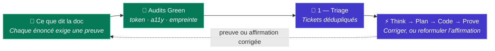

# 🌱 Green IT

L’usine traite l’énergie, les tokens et l’accessibilité comme des contraintes de livraison, et non comme un rapport rédigé après coup.

> **Pas d’affirmation sans preuve.** Chaque énoncé de cette page est relié à un mécanisme du modèle et à un
> agent d’audit qui le vérifie. Une affirmation qu’aucun audit ne peut vérifier est reformulée ou retirée.

## Principe

Le token, la minute de CI et l’octet les moins chers sont ceux qu’on ne dépense jamais. Le Green IT dans l’usine a deux volets :

1. **Une livraison sobre** : l’usine dépense le moins de tokens et de minutes de CI possible pour livrer un changement.
2. **Un produit sobre et accessible** : le logiciel livré est léger, rapide et utilisable par tous.

Les tokens sont un **indicateur indirect** de l’énergie, pas une mesure. L’usine rapporte les tokens, les tentatives, les minutes de CI
et le poids des pages. Elle ne publie pas de chiffres carbone qu’elle ne sait pas mesurer.

## Une livraison sobre

| Levier | Mécanisme | Où il est défini |
|---|---|---|
| **Modèle dimensionné par étape** | Chaque agent déclare le niveau de modèle adapté à sa tâche ; le raisonnement de pointe est concentré dans Think | [Gestion des coûts](./cost-management#selection-optimisee-des-modeles-par-etape) |
| **Cadrer avant de générer** | L’entonnoir Think → Plan → Code fixe l’architecture et le périmètre de fichiers avant toute écriture de code | [Gestion des coûts](./cost-management) |
| **Fenêtres de contexte réduites** | Les instructions sont courtes et ciblées sur des motifs de fichiers étroits ; l’agent de code ne charge que les fichiers de l’étape courante | [Contexte persistant](./persistent-context) |
| **Ne jamais régénérer l’existant** | Think lie des briques éprouvées de la Forge au lieu de les générer de nouveau | [Forge](./forge) |
| **Contrôles à zéro token d’abord** | Compilateurs, linters, vérificateurs de types et tests s’exécutent avant toute revue par l’IA | [Contrôles déterministes](./deterministic-controls) |
| **Tentatives bornées** | Une étape atomique par tour et un plafond strict de tentatives stoppent les boucles et escaladent au développeur | [Code](./stage-code) |
| **Corriger une fois, pour toutes les squads** | Une erreur répétée devient une évolution du contexte dans Learn : aucune squad ne la paie deux fois | [Learn](./stage-learn) |
| **Consommation attribuée** | Tokens et coûts sont enregistrés par ticket, étape et squad : le gaspillage est visible et revu chaque semaine | [Gestion des coûts](./cost-management) |

## Un produit sobre et accessible

L’usine transporte les exigences non fonctionnelles de Plan jusqu’à Prove, où elles sont vérifiées comme n’importe quel autre critère d’acceptation.

| Propriété | Référentiel | Comment elle est vérifiée |
|---|---|---|
| **Accessibilité** | WCAG 2.2 AA (et les obligations EN 301 549 / RGAA qui s’appuient dessus) | Règles d’accessibilité dans les tests E2E, plus un audit statique à la demande des gabarits et pages (`a11y-audit`) |
| **Performance** | Budgets déclarés par projet : poids de page, nombre de requêtes, métriques de chargement | Tests de performance ([k6](https://alten-group.github.io/coding-pal/guide/domain-testing)) et audit à la demande du livrable construit (`web-footprint-audit`) |
| **Éco-conception** | RGESN (référentiel général d’écoconception de services numériques) et GR491 | Audit à la demande (`web-footprint-audit`) : appels tiers, polices, images, JS et CSS inutilisés, cache, animations |
| **Réutiliser plutôt que reconstruire** | Levier des dépendances et de la Forge | Audits hebdomadaires de code mort et de levier des dépendances |

Les outils automatiques ne couvrent qu’une partie de l’accessibilité. Les parcours lecteur d’écran et clavier qui demandent une personne sont listés
comme `manual-check-needed` dans le rapport d’audit, et jamais déclarés réussis.

## Comment les énoncés restent honnêtes

Trois agents d’audit en lecture seule du [catalogue coding-pal](https://alten-group.github.io/coding-pal/guide/domain-green-it) sont disponibles pour tout projet. Seul `token-audit` est planifié aujourd’hui (chaque semaine, sur coding-pal) ; les deux autres s’exécutent à la demande tant qu’un projet ne les ajoute pas à son calendrier d’audit. Ils fonctionnent sur n’importe quel projet, et appliquent les limites déclarées par le projet (taille, périmètre) plutôt que leurs valeurs par défaut.

| Agent | Ce qu’il vérifie | Sortie |
|---|---|---|
| **Token Auditor** (`token-audit`) | Le harness lui-même : périmètres trop larges, instructions, skills, agents et prompts volumineux ou dupliqués, boucles sans plafond, étapes IA qu’un script saurait faire. S’exécute chaque semaine sur [coding-pal](https://alten-group.github.io/coding-pal/), la source du harness : une correction profite à tous les projets | Constats avec taille mesurée et tokens estimés |
| **Accessibility Auditor** (`a11y-audit`) | Défauts WCAG 2.2 AA avec fichier, ligne et règle | Constats et liste `manual-check-needed` |
| **Web Footprint Auditor** (`web-footprint-audit`) | Octets par page, requêtes, origines tierces, polices, images, cache, face aux budgets déclarés | Valeurs mesurées et dépassements de budget |

Un constat se ferme de deux façons : on ajoute le contrôle manquant, ou on reformule l’énoncé pour qu’il soit vrai.
Les audits mesurent le projet ; une personne confronte la page aux résultats.

## Indicateurs

| Indicateur | Sens | Source |
|---|---|---|
| Tokens et coût par changement fusionné | Baisse | [Gestion des coûts](./cost-management) |
| Itérations de boucle de correction et taux de réussite au premier passage dans Code | Boucles en baisse, taux en hausse | [Contexte persistant](./persistent-context) |
| Nombre et taille des instructions | Stable | Token Auditor |
| Part des briques Forge réutilisées plutôt que générées | Hausse | [Forge](./forge) |
| Défauts d’accessibilité ouverts | Baisse | Accessibility Auditor |
| Poids des pages et requêtes tierces face au budget | Dans le budget | Web Footprint Auditor |

## Ce que l’usine n’affirme pas

- Aucun chiffre carbone ou kWh : les tokens et minutes de CI sont rapportés, pas convertis en émissions.
- Aucune affirmation que la livraison assistée par IA est plus verte que la livraison manuelle. Elle est conçue pour gaspiller moins qu’un usage ad hoc de l’IA, ce qui est différent.
- Aucune déclaration de conformité d’accessibilité pour un produit tant que son audit et ses vérifications manuelles ne sont pas terminés.

## Compromis

- **Les ré-exécutions de CI propres** répètent des contrôles déjà lancés par l’agent. Elles consomment du calcul et sont conservées car l’agent ne peut pas en influencer le résultat.
- **Le raisonnement de pointe dans Think** coûte plus cher par appel. Il est conservé car une décision juste économise de nombreux tokens de code.
- **Les environnements de prévisualisation** consomment des ressources tant qu’ils existent et sont liés à la pull request qu’ils valident.

Chaque compromis est revu avec les données hebdomadaires de coût et d’audit, et modifié quand les preuves l’exigent.
