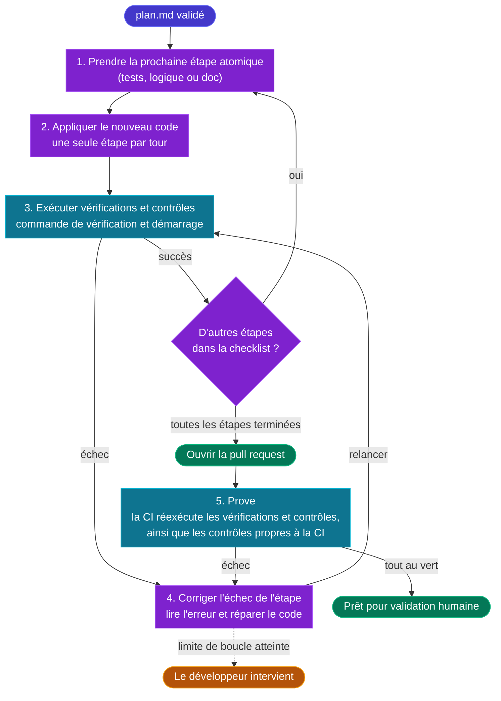

# ⚡ 4 — Code

  ÉTAPE 4
  Boucles autonomes rapides : générer, tester et corriger jusqu’au vert

Là où les spécifications et les plans deviennent du logiciel exécutable. Dans l’Agentic Software Factory, **les développeurs ne codent pas manuellement** : les agents IA génèrent de manière autonome le code, les tests et la documentation, en itérant dans des boucles fermées et rapides jusqu’à ce que toutes les vérifications, tous les tests et tous les contrôles soient au vert.

## Objectif

| Entrée | Sortie | Responsable |
|---|---|---|
| Un élément de travail ayant franchi le jalon [3 — Plan](./stage-plan) | Une pull request dont toutes les vérifications CI passent | Développeur (en supervision d’agents IA autonomes) |

## La boucle de codage autonome

1. **Exécution atomique étape par étape.** L’agent parcourt le dossier Plan validé **une étape à la fois**, plutôt que de tenter de générer le code, les tests et la documentation d’un seul bloc :
   - **Les étapes de test d’abord (ou conjointement à la logique) :** les tests sont générés directement à partir des critères d’acceptation du dossier Plan afin de prouver l’exigence avant ou pendant l’implémentation.
   - **Les étapes d’implémentation :** l’agent applique le bloc `New Code` de l’étape, associe les briques de la Forge et s’assure que l’application reste démarrable après chaque étape.
   - **Les étapes de documentation et de contrat :** les schémas OpenAPI, les guides README/VitePress et les bascules de migration sont des étapes distinctes de la checklist, exécutées et vérifiées une fois que le code se comporte comme prévu.
2. **Boucle de vérification autonome rapide.** Après avoir appliqué chaque étape, l’agent exécute immédiatement la commande `Verification` et le `Bootable Check` de l’étape, ainsi que les [contrôles déterministes](./deterministic-controls) pertinents (gardes, jalons, contrats). Leur exécution locale prend quelques secondes, et non un aller-retour CI complet. Si une vérification échoue, l’agent analyse l’erreur et répare l’étape dans une boucle de correction strictement bornée.
3. **Contexte et Forge.** L’agent respecte le Contexte persistant et importe depuis [la Forge](./forge) les briques associées lors de l’étape Think.
4. **Travail commité.** Une fois toutes les étapes du plan vérifiées et au vert, l’agent commite la branche et ouvre la pull request.
   La CI réexécute alors les vérifications et les contrôles, ainsi que les contrôles qui ne s’exécutent qu’en CI. S’ils échouent, l’agent corrige le code et la boucle repart. Le développeur n’intervient que lorsque la limite de la boucle de correction est atteinte.

## Règles non négociables

- **Une étape par tour.** Les agents exécutent exactement une étape atomique de la checklist du Plan par tour. Générer des applications entières, des tests et de la documentation en un seul prompt est interdit : cela épuise la fenêtre de contexte du LLM, introduit des régressions et empêche toute vérification granulaire.
- **Les développeurs n’écrivent pas de code manuellement.** Toute tentative d’écriture manuelle de code dans un IDE est un anti-patron qui contourne le Contexte persistant et ralentit la livraison.
- **Au vert avant la PR.** Un agent n’est jamais autorisé à ouvrir une pull request avec un build en échec, une erreur de typage, une erreur de lint, un test en échec ou un contrôle en échec. L’agent continue d’itérer jusqu’à ce que tout passe, dans la limite de 5 tentatives de boucle de correction par élément de travail. Avoir besoin de plus de 3 tentatives est un signal d’alerte indiquant que le plan était trop vaste ou trop vague (voir [Métriques](./metrics)).
- **Les tests sont générés en même temps que le code, jamais après coup.** Les tests découlent strictement des critères d’acceptation du dossier Plan ; ils ne sont jamais générés a posteriori pour coller au code écrit.
- **Le contexte est le volant de direction.** Si un agent produit du code incorrect ou interprète mal un modèle de conception, le développeur met à jour le Contexte persistant plutôt que de corriger manuellement le code.
- **Les dépendances sont encadrées.** Toute nouvelle dépendance introduite par un agent doit être explicitement déclarée dans le plan et évaluée par les contrôles de sécurité et de licence.

## Gestion des branches

Des branches de fonctionnalités à courte durée de vie sont créées directement par les agents à partir de `main` ou `develop`, puis fusionnées via des pull requests.
Les branches à longue durée de vie sont interdites : elles engendrent des conflits de fusion qui brisent le contexte agentique.

## Où l’IA est utilisée

| Tâche | Rôle de l’IA | Rôle humain |
|---|---|---|
| Logique métier et services applicatifs | Générer à partir du dossier Plan | Valider la fidélité aux critères d’acceptation du Plan |
| Squelette applicatif, code répétitif (*boilerplate*), câblage | Générer à partir des modèles de la Forge | Aucun |
| Tests unitaires, d’intégration et de contrat | Générer en parallèle du code, à partir des critères d’acceptation | Vérifier que les tests découlent bien des critères d’acceptation |
| Clients d’API, modèles de données, mappers, migrations | Générer selon les contrats de la Forge | Garantir le respect des contraintes de rétrocompatibilité |
| Refactoring architectural dans le respect des patrons | Refactorer à l’intérieur des frontières enregistrées | Confirmer les frontières du système |
| Documentation, spécifications OpenAPI, runbooks | Générer | Relire pour vérifier la clarté |
| Boucles de correction sur échecs de build, erreurs de type, lint et tests | Analyser l’échec et réparer | Intervenir uniquement si l’agent atteint sa limite |

## Primitives dans le Contexte persistant

L’étape Code s’appuie sur des primitives du Contexte persistant publiées par [coding-pal](https://alten-group.github.io/coding-pal/) :

### Primitives d’exécution et de cycle de vie
- Un agent **Code Agent** implémente le Plan validé une étape par tour : il applique `New Code`, exécute les commandes de vérification et répare automatiquement les contrôles en échec.
- Une instruction **code-loop** impose la discipline de codage : pas de code écrit à la main, 1 étape par tour, tout au vert avant la PR, branches à courte durée de vie, dépendances encadrées et limite stricte de 5 tours de boucle de correction.
- Une compétence (*skill*) **code-loop** suit l’avancement des étapes dans `progress.json`, vérifie la durée de vie de la branche et interrompt l’exécution lorsque les boucles de correction dépassent les seuils afin qu’un développeur puisse intervenir.
- Une compétence **pr-record** formate et valide le dossier de pull request : liens vers le ticket de backlog et le Plan, traçabilité des critères, dépendances déclarées et rayon d’impact.

### Instructions de pile technique, de test et de documentation
Lorsque l’agent modifie des couches spécifiques de l’application, des instructions ciblées dans le Contexte persistant orientent automatiquement les patrons et conventions :
- **Backend et API** : `node-express.instructions.md` (architecture en couches, enveloppes d’erreur, middlewares de sécurité) et `node-api-tests.instructions.md` (contrats de points de terminaison Supertest).
- **Frontend** : `angular-admin.instructions.md` (découpage par fonctionnalité, *signals*, composants PrimeNG) et `angular-unit-tests.instructions.md` / `angular-e2e-tests.instructions.md` (tests unitaires Vitest et tests de bout en bout Playwright).
- **Base de données et persistance** : `postgres-liquibase.instructions.md` (*changeSets* audités, déclencheurs d’historique, rollbacks) et `postgres-liquibase-tests.instructions.md` (assertions déterministes de migration SQL).
- **Infrastructure et conteneurisation** : `docker.instructions.md` (piles Compose multi-étapes, montages de secrets BuildKit, utilisateurs non-root).
- **Documentation et sites** : `vitepress-docs.instructions.md` (guides techniques VitePress, diagrammes Mermaid, routage Traefik `/docs`) et `migration-docs.instructions.md` (dossiers de migration structurés, runbooks de bascule, documentation garantie sans secret).
- **Socle de qualité et de remédiation** : `sharp-agent.instructions.md` (diffs chirurgicaux universels, zéro gaspillage de tokens, priorité à la simplicité).

### Entrées et briques
- Le **dossier Plan** (`plan.md`) et les **briques de la Forge** associées (`forge/<id>@<version>`) constituent les entrées directes qui guident la génération de code par l’agent.

Consultez le [guide Code de coding-pal](https://alten-group.github.io/coding-pal/guide/domain-code) et le [guide des piles techniques (Tech Stacks)](https://alten-group.github.io/coding-pal/guide/domain-stacks).

## Jalon de sortie

Une pull request quitte l’étape Code et entre dans [Prove](./stage-prove) lorsque :

1. l’agent a généré le code, les tests et la documentation à partir du Plan validé, en utilisant les briques associées de la Forge le cas échéant et en suivant les instructions et contraintes du Contexte persistant,
2. tous les critères d’acceptation du dossier Plan disposent de tests automatisés correspondants,
3. le build, la vérification de typage, le linter, les tests générés et les contrôles déterministes passent tous sans aucune erreur,
4. la pull request pointe vers le ticket de backlog et le Plan.
