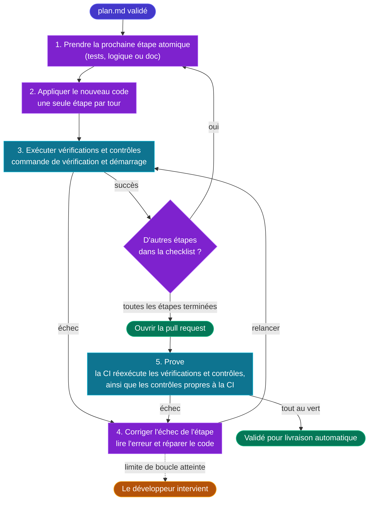

# ⚡ 4 — Code

  ÉTAPE 4
  Boucles autonomes rapides : générer, tester et corriger jusqu’au vert

L’IA implémente le plan, écrit les tests et la documentation, puis corrige les contrôles en échec dans la limite de tentatives. **Les développeurs ne codent pas manuellement.**

## Objectif

| Entrée | Sortie | Responsable |
|---|---|---|
| Un élément de travail ayant franchi le jalon [3 — Plan](./stage-plan) | Une pull request dont toutes les vérifications CI passent | Développeur (en supervision d’agents IA autonomes) |

## La boucle de codage autonome

1. **Implémenter une étape à la fois.** Écrire les tests depuis les critères, avant ou avec le code. Appliquer `New Code`, utiliser les briques Forge et garder l’application démarrable. Traiter les documents et contrats dans des étapes séparées.
2. **Vérifier et corriger.** Exécuter `Verification`, `Bootable Check` et les [contrôles](./deterministic-controls) pertinents. Corriger dans la limite de tentatives.
3. **Suivre le contexte.** Respecter les règles du dépôt et utiliser les briques choisies dans [la Forge](./forge).
4. **Ouvrir la demande de fusion.** Commiter seulement quand toutes les étapes passent. Prove relance les contrôles en CI ; les agents corrigent jusqu’à la limite, puis un développeur intervient.

## Règles non négociables

- **Une étape par tour.** Ne jamais générer une application entière en un prompt.
- **Pas de code manuel.** Guider les agents par les spécifications, le contexte et les contrôles.
- **Au vert avant la PR.** Builds, typage, lint, tests et contrôles doivent passer. Arrêt après **5 tentatives de correction par ticket**. Au-delà de 3, le plan est probablement trop gros ou vague (voir [Métriques](./metrics)).
- **Les tests sont générés en même temps que le code, jamais après coup.** Les tests découlent strictement des critères d’acceptation du dossier Plan ; ils ne sont jamais générés a posteriori pour coller au code écrit.
- **Le contexte est le volant de direction.** Si un agent produit du code incorrect ou interprète mal un modèle de conception, le développeur met à jour le Contexte persistant plutôt que de corriger manuellement le code.
- **Les dépendances sont encadrées.** Toute nouvelle dépendance introduite par un agent doit être explicitement déclarée dans le plan et évaluée par les contrôles de sécurité et de licence.

## Gestion des branches

Des branches de fonctionnalités à courte durée de vie sont créées directement par les agents à partir de `main` ou `develop`, puis fusionnées via des pull requests.
Les branches à longue durée de vie sont interdites : elles engendrent des conflits de fusion qui brisent le contexte agentique.

## Où l’IA est utilisée

| Tâche | Rôle de l’IA | Gestion humaine des exceptions |
|---|---|---|
| Logique métier et services applicatifs | Implémenter le Plan | Clarifier les critères ambigus |
| Squelette applicatif, code répétitif (*boilerplate*), câblage | Générer à partir des modèles de la Forge | Aucun |
| Tests unitaires, d’intégration et de contrat | Générer depuis les critères | Résoudre les lacunes que les contrôles ne tranchent pas |
| Clients d’API, modèles de données, mappers, migrations | Générer selon les contrats Forge | Résoudre les blocages de compatibilité |
| Refactoring architectural | Respecter les frontières consignées | Résoudre les frontières contradictoires |
| Documentation, spécifications OpenAPI, runbooks | Générer et valider | Clarifier l’intention manquante |
| Boucles de correction sur échecs de build, erreurs de type, lint et tests | Analyser l’échec et réparer | Intervenir uniquement si l’agent atteint sa limite |

## Agents et skills {#primitives-dans-le-contexte-persistant}

L’étape Code s’appuie sur des primitives du Contexte persistant publiées par [coding-pal](https://alten-group.github.io/coding-pal/) :

### Primitives d’exécution et de cycle de vie
- Un agent **Code Agent** implémente le Plan validé une étape par tour : il applique `New Code`, exécute les commandes de vérification et répare automatiquement les contrôles en échec.
- Une instruction **code-loop** impose la discipline de codage : pas de code écrit à la main, 1 étape par tour, tout au vert avant la PR, branches à courte durée de vie, dépendances encadrées et limite stricte de 5 tours de boucle de correction.
- Une compétence (*skill*) **code-loop** suit l’avancement des étapes dans `progress.json`, vérifie la durée de vie de la branche et interrompt l’exécution lorsque les boucles de correction dépassent les seuils afin qu’un développeur puisse intervenir.
- Une compétence **pr-record** formate et valide le dossier de pull request : liens vers le ticket de backlog et le Plan, traçabilité des critères, dépendances déclarées et rayon d’impact.

### Instructions de pile technique, de test et de documentation
Des instructions ciblées guident chaque couche applicative :
- **Backend et API** : `node-express.instructions.md` (architecture en couches, enveloppes d’erreur, middlewares de sécurité) et `node-api-tests.instructions.md` (contrats de points de terminaison Supertest).
- **Frontend** : `angular-admin.instructions.md` (découpage par fonctionnalité, *signals*, composants PrimeNG) et `angular-unit-tests.instructions.md` / `angular-e2e-tests.instructions.md` (tests unitaires Vitest et tests de bout en bout Playwright).
- **Base de données et persistance** : `postgres-liquibase.instructions.md` (*changeSets* audités, déclencheurs d’historique, rollbacks) et `postgres-liquibase-tests.instructions.md` (assertions déterministes de migration SQL).
- **Infrastructure et conteneurisation** : `docker.instructions.md` (piles Compose multi-étapes, montages de secrets BuildKit, utilisateurs non-root).
- **Documentation et sites** : `vitepress-docs.instructions.md` (guides techniques VitePress, diagrammes Mermaid, routage Traefik `/docs`) et `migration-docs.instructions.md` (dossiers de migration structurés, runbooks de bascule, documentation garantie sans secret).
- **Socle de qualité et de remédiation** : `sharp-agent.instructions.md` (diffs chirurgicaux universels, zéro gaspillage de tokens, priorité à la simplicité).

### Entrées et briques
- Le **dossier Plan** (`plan.md`) et les **briques de la Forge** associées (`forge/<id>@<version>`) constituent les entrées directes qui guident la génération de code par l’agent.

Consultez le [guide Code de coding-pal](https://alten-group.github.io/coding-pal/guide/domain-code) et le [guide des piles techniques (Tech Stacks)](https://alten-group.github.io/coding-pal/guide/domain-stacks).

## Pipeline de livraison

Le pipeline Code implémente le plan et ouvre une demande de fusion (pull request ou merge request), selon les [déclencheurs et points de revue communs](./platform-rails#declencheurs-points-de-revue-et-statuts) :

1. Restaure les spécifications Think et Plan et détermine la branche de base.
2. Positionne le statut de phase du ticket sur **Code** avant le début de l’implémentation.
3. Crée la branche, implémente le plan et prépare le dossier de demande de fusion.
4. Exécute tests, build, contrôles de périmètre et vérifications de préparation de livraison applicables.
5. Pousse la branche et crée ou met à jour la demande de fusion.
6. Si un point de revue humaine a été demandé, conserve le statut **Code** et signale la pause. Sinon, transmet les spécifications et la référence de demande de fusion à [Prove](./stage-prove#pipeline-de-livraison).

**Point d’arrêt :** revue demandée ou passage à Prove. **Code ne fusionne pas.** Le statut reste **Code** pendant la revue.

Après revue, reprenez la demande existante à Prove. Le statut change au démarrage de Prove. Signalez les échecs non résolus à un développeur ; le travail indépendant peut continuer.

## Jalon de sortie

Une pull request quitte l’étape Code et entre dans [Prove](./stage-prove) lorsque :

1. l’agent a généré le code, les tests et la documentation à partir du Plan validé, en utilisant les briques associées de la Forge le cas échéant et en suivant les instructions et contraintes du Contexte persistant,
2. tous les critères d’acceptation du dossier Plan disposent de tests automatisés correspondants,
3. le build, la vérification de typage, le linter, les tests générés et les contrôles déterministes passent tous sans aucune erreur,
4. la pull request pointe vers le ticket de backlog et le Plan.
