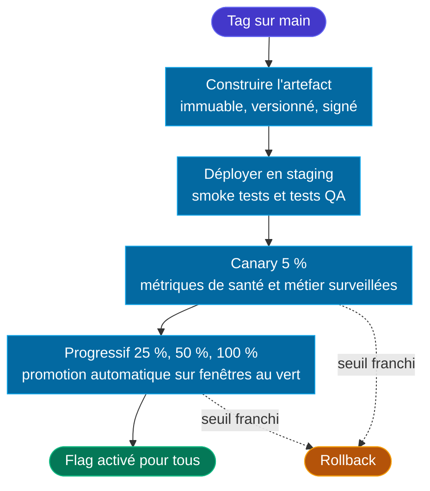

# 🚀 6 — Release

  ÉTAPE 6
  Déploiement automatisé, réversible à chaque étape

L’étape Release livre en toute sécurité un changement qui a franchi l’étape Prove. Le changement est déployé automatiquement sur un environnement de test, puis en production. En production, il est exposé progressivement aux utilisateurs, et chaque étape peut être annulée rapidement en cas de problème.

Déployer et mettre en service (*releaser*) sont deux choses distinctes. Déployer consiste à pousser le nouveau code en production, désactivé. Mettre en service consiste à l’activer pour les utilisateurs, d’abord pour quelques-uns, puis pour tout le monde.

## Objectif

| Entrée | Sortie | Responsable |
|---|---|---|
| Un changement ayant franchi [5 — Prove](./stage-prove) | De la valeur en production, observable et réversible | DevOps |

## Modèle

- *Trunk-based* : un tag sur `main` déclenche la release.
- Chaque release produit un artefact immuable et versionné.
- Le déploiement est automatique vers `staging`, puis progressif vers `production`.
- Le *feature flag* `enable` permet de déployer le code avant de l’activer pour les utilisateurs.
- Chaque release utilise la métrique de résultat déjà engagée dans le ticket de backlog de [1 — Triage](./stage-triage). L’étape [7 — Learn](./stage-learn) prend ensuite le relais et l’évalue une fois le déploiement progressif terminé.

Le *feature flag* `enable` constitue la véritable décision de mise en service. Tout ce qui précède relève du déploiement. Les chemins de retour arrière sont détaillés dans la section [Rollback](#rollback) ci-dessous.

## Règles de déploiement progressif (*rollout*)

Le pipeline de déploiement applique quelques règles fixes à chaque étape. Ce sont des fonctionnalités standard des outils de livraison progressive, et aucune IA n’intervient dans ces décisions.

| Règle | Ce qu’elle vérifie | Effet |
|---|---|---|
| **Promotion** | Les métriques de santé et les métriques métier restent dans leurs seuils pendant toute la fenêtre d’observation | Le déploiement passe automatiquement à l’étape suivante |
| **Vérification de santé (*Health check*)** | Smoke tests et tests QA en staging, puis taux d’erreur, latence et saturation à chaque palier en production | Une vérification en échec interrompt le déploiement |
| **Seuil de rollback** | Une limite déclarée par changement avant le déploiement | Son franchissement déclenche automatiquement le rollback |

La surveillance des problèmes après la mise en service complète relève de [7 — Learn](./stage-learn).

## Rollback {#rollback}

| Mécanisme | Délai d’effet | Utilisé pour |
|---|---|---|
| Désactivation du *feature flag* | Quelques secondes | Régressions fonctionnelles ou comportementales |
| Bascule du trafic vers la version précédente | < 1 minute | Défaillances liées au déploiement |
| Redéploiement de l’artefact précédent | Quelques minutes | Problèmes de configuration ou d’exécution |
| Correctif en avant (*Forward fix*) | Quelques heures | Problèmes affectant les données où un retour arrière est risqué |

Tout changement ayant un rayon d’impact **Élevé** ou **Critique** voit son mécanisme de rollback désigné dans le [dossier Think](./stage-think#the-think-record) et validé lors de [5 — Prove](./stage-prove) avant d’être déployé. Un changement sans chemin de rollback n’est jamais déployé.

## Où l’IA est utilisée

L’IA ne joue aucun rôle dans le déroulement de l’étape Release elle-même. Les notes de version (*release notes*) et le journal des modifications (*changelog*) sont rédigés à partir des pull requests fusionnées durant l’étape Code, et un développeur les approuve. Le déploiement progressif s’exécute sur des outils de déploiement standard, sans intervention de l’IA.

## Primitives dans le Contexte persistant

L’étape Release sépare la déclaration de l’exécution, en s’appuyant sur des primitives publiées par [coding-pal](https://alten-group.github.io/coding-pal/) :

### Primitives de déclaration et de planification
- Un agent **Release Planner** synthétise le rayon d’impact et le rollback issus de `think.md`, le périmètre de fichiers de `plan.md` et la métrique de résultat de `triage.md` au sein de la déclaration `release.md`.
- Une instruction **release** impose les standards de mise en production : déployer n’est pas mettre en service, le *feature flag* incarne la décision d’ouverture, les releases sont strictement bornées aux tickets principaux (évitant les lots volumineux inutiles), les artefacts sont immuables et versionnés, et l’approbation DevOps est requise avant le tag.

### Compétences de jalon déterministe et de déploiement
- Une compétence **release-plan (validator)** (`validate-release.mjs`) contrôle de façon déterministe la déclaration : elle prouve la parité du palier de risque avec Think et Plan, vérifie la progression stricte des paliers de pourcentage canary, valide les seuils de santé (taux d’erreur, latence, saturation) et vérifie le mécanisme de rollback.
- Une compétence **release-plan (evaluator)** (`evaluate-rollout.mjs`) lit les métriques d’observabilité en direct pendant le déploiement pour calculer de manière déterministe la décision **promote** (promouvoir), **hold** (suspendre) ou **rollback** (revenir en arrière), sans aucune intervention de l’IA.

### Infrastructure de pipeline et dossiers
- Le **dossier Release** (`specs/issue-<n>/release.md`) définit les étapes de déploiement progressif, les fenêtres d’observation, les seuils et la métrique de résultat pour Learn.
- Un **modèle de workflow de release** (`release.yml`) fournit le pipeline GitHub Actions de déploiement progressif (tag d’artefact, smoke check en staging, paliers canary et exécution automatisée du rollback).

Consultez le [guide Release de coding-pal](https://alten-group.github.io/coding-pal/guide/domain-release).

## Jalon de sortie

Une release est terminée lorsque le déploiement a atteint 100 %, que la fenêtre d’observation s’est écoulée sans franchissement de seuil et que le tableau de bord d’observabilité du changement est actif dans [Learn](./stage-learn).
