# 💰 Cost Management

Ad-hoc AI usage burns tokens invisibly: developers paste whole files into chat, use frontier models for trivial edits, and let agents spin in open-ended retry loops. At the end of the month, the organization gets a single invoice with no link to what shipped.

The Agentic Software Factory turns AI spend into a **governed, attributable unit cost per delivered outcome**.

## Why the factory lowers token spend

| Ad-hoc AI usage | The Agentic Software Factory |
|---|---|
| Frontier model used for every chat and autocomplete | **Right-sized model per stage** matched to the cognitive load of each task |
| Vague prompt sent straight to a coding agent | **3-step Think → Plan → Code funnel** narrows scope before any code is generated |
| Entire repository stuffed into context windows | **Explicit file scope** in Plan and narrowly scoped instructions in Persistent Context |
| Agents retry indefinitely when checks fail | **Hard retry cap** halts runaway token burn and escalates to a developer |
| Teams regenerate boilerplate, auth, and scaffolding | **[The Forge](./forge)** binds pre-built, tested assets at zero generation cost |
| LLM asked to spot syntax, lint, or type errors | **[Deterministic Controls](./deterministic-controls)** catch errors first at zero token cost |
| Unattributed monthly API bill | **Per-issue, per-stage, and per-squad attribution** linked to business outcomes |

## Optimized model selection per stage

Not every task needs a frontier reasoning model. Each agent primitive in [Persistent Context](./persistent-context) declares the model tier suited to its job:

| Stage | Cognitive task | Model tier | Why it optimizes cost |
|---|---|---|---|
| **[0 — Meet](./stage-meet)** & **[1 — Triage](./stage-triage)** | Transcript structuring, quote extraction, backlog scoring | Fast, low-cost extraction & classification models | High-volume text processing runs on lightweight models at a fraction of frontier pricing |
| **[2 — Think](./stage-think)** | Option trade-offs, [Forge](./forge) discovery, blast radius | High-reasoning frontier model | Concentrates reasoning spend where one sound architectural choice saves tens of thousands of coding tokens |
| **[3 — Plan](./stage-plan)** | Atomic step breakdown, file scope, testable acceptance criteria | Structured reasoning model | Converts architecture into a bounded checklist once, rather than re-reasoning on every coding turn |
| **[4 — Code](./stage-code)** | Implementing one atomic step and surgical diffs | Fast, cost-efficient coding model | The hard design decisions are already settled in Think and Plan; Code executes small, deterministic steps |
| **[5 — Prove](./stage-prove)** | Clean CI gates, independent diff review, targeted auto-remediation | Zero-token deterministic checks first; review/fixer model only on diff | Compilers, linters, and test runners cost zero tokens; the Prove agent reviews only changes that pass CI |
| **[7 — Learn](./stage-learn)** | Telemetry synthesis, outcome verdict, context proposals | Lightweight analytical model | Summarizes structured production signals without heavy generation |

## Workflow optimization: the 3-step Think → Plan → Code funnel

Sending a raw feature request directly to a coding agent is the single largest source of wasted tokens: the agent scans unrelated files, guesses the architecture, breaks existing contracts, and burns tokens trying to fix its own mistakes.

The **Think → Plan → Code** sequence acts as a token funnel:

```mermaid
---
caption: How Think → Plan → Code shrinks context windows and prevents runaway token burn
config:
  flowchart:
    padding: 8
    wrappingWidth: 280
    nodeSpacing: 30
    rankSpacing: 34
---
flowchart LR
  THINK["💡 2 — Think<br/>Bind Forge assets &amp; lock architecture<br/><i>Avoids generating code that exists</i>"]
  PLAN["📋 3 — Plan<br/>Lock file scope &amp; atomic steps<br/><i>Slashes input context per turn</i>"]
  CODE["⚡ 4 — Code<br/>1 step per turn, capped retries<br/><i>Prevents infinite retry burn</i>"]
  PROVE["✅ 5 — Prove<br/>Deterministic gates before AI review<br/><i>Zero-token checks catch defects first</i>"]

  THINK --> PLAN --> CODE --> PROVE

  classDef think fill:#be185d,stroke:#ec4899,color:#ffffff
  classDef plan fill:#4338ca,stroke:#6366f1,color:#ffffff
  classDef code fill:#7e22ce,stroke:#a855f7,color:#ffffff
  classDef prove fill:#0e7490,stroke:#06b6d4,color:#ffffff
  class THINK think
  class PLAN plan
  class CODE code
  class PROVE prove
```

1. **[2 — Think](./stage-think) eliminates redundant generation.** Before planning, the Thinker agent searches [the Forge](./forge) and binds existing services, libraries, and templates. The cheapest code is the code you never pay an agent to generate or debug.
2. **[3 — Plan](./stage-plan) shrinks input token volume.** Plan defines the exact **file scope**—which files the coding agent may read and touch, and which are off-limits—and breaks the change into atomic steps. Instead of feeding the whole repository on every turn, the coding agent loads only the files for the current step.
3. **[4 — Code](./stage-code) bounds output tokens and retry loops.** The coding agent applies surgical diffs (`sharp-agent` baseline) for one step at a time and runs that step's verification command. A hard retry ceiling stops execution when a step cannot self-heal, escalating to a developer instead of burning tokens in an infinite loop.

## Preventing team token waste and AI misuse

Without structural guardrails, teams waste tokens in predictable ways. The factory prevents each one by design:

| Common team misuse | Why it wastes tokens | How the factory stops it |
|---|---|---|
| **Conversational trial-and-error** ("vibe coding" in chat) | Long back-and-forth threads re-send the entire conversation history on every message | Work runs through stage pipelines from committed specs (`think.md`, `plan.md`), not open-ended chat sessions |
| **Repeating conventions in prompts** | Every developer writes custom paragraphs explaining the same stack rules on every turn | Conventions live once in [Persistent Context](./persistent-context) and are versioned in Git |
| **Unscoped context loading** | Loading a giant global instruction file on every request taxes every prompt | Instructions are small and scoped to narrow file globs |
| **One-shot monolith generation** | Asking an agent to generate an entire feature at once produces truncated or broken output that must be regenerated from scratch | [Code](./stage-code) enforces **one atomic step per turn**, verified before moving to the next step |
| **Using LLMs as compilers or linters** | Paying for reasoning tokens to find missing imports, syntax errors, or type mismatches | [Deterministic Controls](./deterministic-controls) and local build/type/lint scripts run first at zero token cost |
| **Solving the same agent mistake twice** | Fixing an issue in one chat session leaves the next squad to burn tokens hitting the exact same failure | Root-cause fixes update [Persistent Context](./persistent-context) in [7 — Learn](./stage-learn), eliminating repeat token spend across all squads |

## Token attribution and ROI

Because every agent run is triggered from the [unified Git platform](./tooling) and linked to a work item, branch, and pull request, **100% of token consumption is attributed**.

### Knowing what your tokens bought

Every model invocation records its token count and cost against:

| Attribution level | Question it answers |
|---|---|
| **Per work item** | How much model spend did this specific backlog issue consume from [0 — Meet](./stage-meet) to [6 — Release](./stage-release)? |
| **Per stage** | Were tokens spent on upfront reasoning (Think/Plan), step generation (Code), auto-remediation, or independent review (Prove)? |
| **Per merged change** | What is our unit AI cost to ship a validated pull request, and is it trending down as context and Forge reuse mature? |
| **Per squad & workflow** | Which squad or pipeline is driving spend, and which workflows need optimization ([Governance](./governance#auditability))? |

<MetricChart
  title="Cost per merged change as Persistent Context and Forge mature (median per week)"
  unit="USD"
  :labels="['W1', 'W2', 'W3', 'W4', 'W5', 'W6', 'W7', 'W8']"
  :values="[14.5, 12.2, 9.8, 7.6, 6.1, 5.2, 4.5, 3.9]"
  :target="5"
  target-label="target $5"
/>

### Measuring real AI ROI

Most organizations cannot calculate AI ROI because they compare a flat monthly licence or API bill against subjective developer surveys. In the Agentic Software Factory, ROI is calculated directly from engineering and business evidence:

1. **Exact cost input**: you know the exact dollar cost of tokens and CI minutes consumed to deliver a feature.
2. **Attributed business return**: because every feature traces from a client quote in [0 — Meet](./stage-meet) to a production outcome verdict in [7 — Learn](./stage-learn), you compare the exact token cost of building the feature against the customer or operational value it produced.
3. **Actionable cost governance**: model spend is reviewed weekly per squad ([Governance](./governance#cost)). Any workflow whose token cost exceeds the value it creates is refactored—moved to a smaller model, constrained with tighter context, replaced by a zero-token deterministic script, or retired. For delivery speed, quality, and autonomy indicators, see [Metrics](./metrics).
