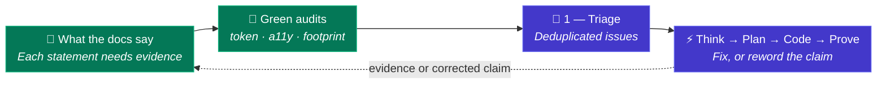

# 🌱 Green IT

The factory treats energy, tokens, and accessibility as delivery constraints, not just as a report written afterwards.

> **No claim without evidence.** Every statement on this page is tied to a mechanism in the model and to an
> audit agent that checks it. Statements that no audit can verify are reworded or removed.

## Principle

The cheapest token, build minute, and byte is the one that is never spent. Green IT in the factory has two halves:

1. **Sober delivery**: the factory spends as few tokens and CI minutes as possible to ship a change.
2. **Sober, accessible product**: the software it ships is light, fast, and usable by everyone.

Tokens are a **proxy** for energy, not a measure of it. The factory reports tokens, retries, CI minutes, and page weight.
It does not publish carbon figures it cannot measure.

## Sober delivery

| Lever | Mechanism | Where it is defined |
|---|---|---|
| **Right-sized model per stage** | Each agent declares the model tier suited to its task; frontier reasoning is concentrated in Think | [Cost Management](./cost-management#optimized-model-selection-per-stage) |
| **Narrow the work before generating** | The Think → Plan → Code funnel fixes architecture and file scope before any code is written | [Cost Management](./cost-management#workflow-optimization-the-3-step-think-→-plan-→-code-funnel) |
| **Small context windows** | Instructions are short and scoped to narrow file globs; the coding agent loads only the files of the current step | [Persistent Context](./persistent-context#rules) |
| **Never regenerate what exists** | Think binds proven assets from the Forge instead of generating them again | [Forge](./forge) |
| **Zero-token checks first** | Compilers, linters, type checkers, and tests run before any AI review | [Deterministic Controls](./deterministic-controls) |
| **Bounded retries** | One atomic step per turn and a hard retry cap stop runaway loops and escalate to a developer | [Code](./stage-code) |
| **Fix once, for every squad** | A repeated mistake becomes a context change in Learn, so no squad pays for it twice | [Learn](./stage-learn) |
| **Attributed consumption** | Tokens and cost are recorded per work item, stage, and squad, so waste is visible and reviewed weekly | [Cost Management](./cost-management#token-attribution-and-roi) |

## Sober, accessible product

The factory carries non-functional requirements from Plan into Prove, where they are checked like any other
acceptance criterion.

| Property | Reference standard | How it is checked |
|---|---|---|
| **Accessibility** | WCAG 2.2 AA (and the EN 301 549 / RGAA obligations that build on it) | Accessibility rules in E2E tests, plus an on-demand static audit of templates and pages (`a11y-audit`) |
| **Performance** | Declared budgets per project: page weight, request count, load metrics | Performance tests ([k6](https://alten-group.github.io/coding-pal/guide/domain-testing)) and an on-demand audit of the built output (`web-footprint-audit`) |
| **Eco-design** | RGESN (French eco-design framework) and GR491 | On-demand audit (`web-footprint-audit`): third-party calls, fonts, images, unused JS and CSS, caching, motion |
| **Reuse over rebuild** | Dependency and Forge leverage | Weekly dependency-leverage and dead-code audits |

Automated tools cover only part of accessibility. Screen-reader and keyboard journeys that need a person are listed
as `manual-check-needed` in the audit report, never reported as passed.

## How the statements are kept honest

Three read-only audit agents from the [coding-pal catalog](https://alten-group.github.io/coding-pal/guide/domain-green-it) are available to any project. Only `token-audit` is scheduled today (weekly, on coding-pal); the other two run on demand until a project adds them to its audit schedule. They work on any project, not only this one, and use the limits a project declares (size, scope) instead of their defaults.

| Agent | What it verifies | Output |
|---|---|---|
| **Token Auditor** (`token-audit`) | The harness itself: over-broad scopes, oversized or duplicated instructions, skills, agents, and prompts, loops without a retry cap, LLM steps a script could do. Runs weekly on [coding-pal](https://alten-group.github.io/coding-pal/), the source of the harness, so a fix reaches every project | Findings with measured size and estimated tokens |
| **Accessibility Auditor** (`a11y-audit`) | WCAG 2.2 AA defects with file, line, and rule | Findings plus a `manual-check-needed` list |
| **Web Footprint Auditor** (`web-footprint-audit`) | Bytes per page, requests, third-party origins, fonts, images, caching, against the declared budgets | Measured values and budget breaches |

A finding is closed in one of two ways: the control is added, or the statement is reworded to what is true.
The audits measure the project; a person checks the page against the results.

## Indicators

| Indicator | Direction | Source |
|---|---|---|
| Tokens and cost per merged change | Down | [Cost Management](./cost-management#token-attribution-and-roi) |
| Fix-loop iterations and first-pass green rate in Code | Loops down, green rate up | [Persistent Context](./persistent-context#health-signals) |
| Instruction count and size | Stable | Token Auditor |
| Share of Forge assets reused instead of generated | Up | [Forge](./forge) |
| Accessibility defects open | Down | Accessibility Auditor |
| Page weight and third-party requests vs budget | Within budget | Web Footprint Auditor |

## What the factory does not claim

- No carbon or kWh figure: tokens and CI minutes are reported, not converted into emissions.
- No claim that AI-assisted delivery is greener than manual delivery. It is designed to waste less than ad-hoc AI usage, which is a different statement.
- No accessibility conformance statement for a product until its audit and manual checks are complete.

## Trade-offs

- **Clean CI re-runs** repeat checks the agent already ran. They cost compute and are kept because the agent cannot influence their result.
- **Frontier reasoning in Think** costs more per call. It is kept because one sound decision saves many coding tokens.
- **Preview environments** consume resources while they exist and are tied to the pull request they validate.

Each trade-off is reviewed with the weekly cost and audit data, and is changed when the evidence says so.
