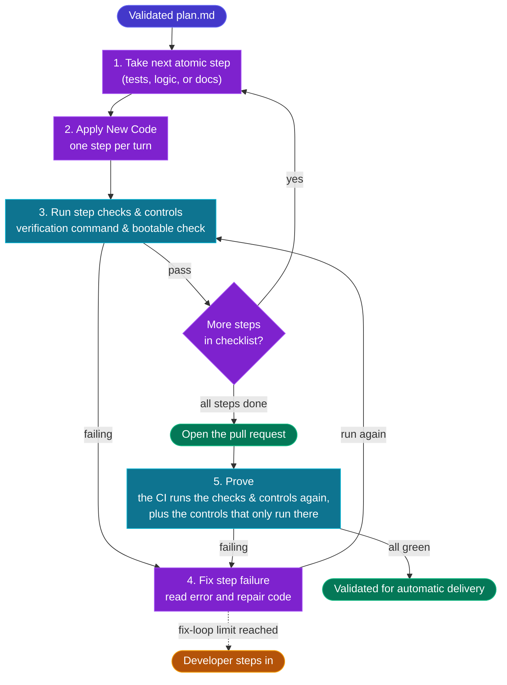

# ⚡ 4 — Code

  STAGE 4
  Fast autonomous loops, generate, test &amp; fix until green

AI implements the plan, writes tests and docs, and fixes failed checks within the retry limit. **Developers do not code manually.**

## Purpose

| Input | Output | Owner |
|---|---|---|
| A work item that passed the [3 — Plan](./stage-plan) gate | A pull request with all CI checks passing | Developer (supervising autonomous AI agents) |

## The autonomous coding loop

1. **Implement one step at a time.** Write tests from the acceptance criteria before or alongside the code. Apply `New Code`, use bound Forge assets, and keep the app bootable. Treat docs and contract updates as separate steps.
2. **Check and repair.** Run each step's `Verification`, `Bootable Check`, and relevant [controls](./deterministic-controls). Fix failures within the retry limit.
3. **Follow context.** Respect repository rules and use the assets selected from [the Forge](./forge).
4. **Open the change request.** Commit only when all steps pass. CI reruns checks in Prove; agents fix failures until the retry limit, then a developer intervenes.

## Non-negotiable rules

- **One step per turn.** Never generate an entire application in one prompt.
- **No manual coding.** Steer agents through specs, context, and controls.
- **Green before PR.** Builds, types, lint, tests, and controls must pass. Stop after **5 fix attempts per work item**. More than 3 suggests a plan that is too big or vague (see [Metrics](./metrics)).
- **Tests are generated alongside code, never retrofitted.** Tests are derived strictly from the
  acceptance criteria in the Plan record, not generated as an afterthought to fit the code.
- **Context is the steering wheel.** If an agent produces incorrect code or misunderstands a pattern,
  the Developer updates Persistent Context rather than manually fixing the code.
- **Dependencies are bounded.** Any new dependency introduced by an agent must be explicitly declared
  in the plan and evaluated against security and licensing controls.

## Branching

Short-lived feature branches created directly by agents from `main` or `develop`, merged through pull requests.
Long-running branches are forbidden: they create merge conflicts that break agentic context.

## Where AI is used

| Task | AI role | Human exception handling |
|---|---|---|
| Domain logic and application services | Implement the Plan | Resolve unclear acceptance criteria |
| Scaffolding, boilerplate, wiring | Generate from Forge templates | None |
| Unit, integration, and contract tests | Generate from the acceptance criteria | Resolve gaps that checks cannot settle |
| API clients, data models, mappers, migrations | Generate against Forge contracts | Resolve blocked compatibility checks |
| Architectural refactoring within patterns | Stay within recorded boundaries | Resolve conflicting boundaries |
| Documentation, OpenAPI specs, runbooks | Generate and validate | Clarify missing intent |
| Fix loops on failing builds, type errors, lint failures, and tests | Parse the failure and repair | Intervene only if the agent reaches its limit |

## Agents and skills {#primitives-in-persistent-context}

Code runs on Persistent Context primitives published by [coding-pal](https://alten-group.github.io/coding-pal/):

### Execution & Lifecycle Primitives
- A **Code Agent** implements the validated Plan one step per turn: applies `New Code`, runs verification commands, and auto-repairs failing checks.
- A **code-loop** instruction enforces coding discipline: no hand-crafted code, 1 step per turn, green before PR, short-lived branches, bounded dependencies, and a strict fix-loop limit of 5.
- A **code-loop** skill tracks step progress in `progress.json`, verifies branch lifespan, and halts execution when fix loops exceed thresholds so a developer can intervene.
- A **pr-record** skill formats and validates the pull request record: links to the backlog issue and Plan, criteria traceability, declared dependencies, and blast radius.

### Tech Stack, Testing & Documentation Instructions
Scoped instructions guide each application layer:
- **Backend & APIs**: `node-express.instructions.md` (layered architecture, error envelopes, security middleware) and `node-api-tests.instructions.md` (Supertest endpoint contracts).
- **Frontend**: `angular-admin.instructions.md` (feature slices, signals, PrimeNG components) and `angular-unit-tests.instructions.md` / `angular-e2e-tests.instructions.md` (Vitest unit and Playwright end-to-end tests).
- **Database & Persistence**: `postgres-liquibase.instructions.md` (audited changeSets, history triggers, rollbacks) and `postgres-liquibase-tests.instructions.md` (deterministic SQL migration assertions).
- **Infrastructure & Containerization**: `docker.instructions.md` (multi-stage Compose stacks, BuildKit secret mounts, non-root users).
- **Documentation & Sites**: `vitepress-docs.instructions.md` (VitePress technical guides, Mermaid diagrams, Traefik `/docs` routing) and `migration-docs.instructions.md` (structured migration records, cutover runbooks, zero-secret documentation).
- **Quality & Remediation Baseline**: `sharp-agent.instructions.md` (universal surgical diffs, zero token waste, simplicity first).

### Inputs & Assets
- The **Plan record** (`plan.md`) and bound **Forge assets** (`forge/<id>@<version>`) are the immediate inputs that steer the agent's code generation.

See the [coding-pal Code guide](https://alten-group.github.io/coding-pal/guide/domain-code) and [Tech Stacks guide](https://alten-group.github.io/coding-pal/guide/domain-stacks).

## Delivery pipeline

The Code pipeline implements the plan and opens a change request (pull request or merge request), using the shared [triggers and checkpoints](./platform-rails#triggers-checkpoints-and-status):

1. Restores the Think and Plan specifications and determines the base branch.
2. Sets the work item's phase status to **Code** before implementation starts.
3. Creates the branch, implements the plan, and prepares the change-request record.
4. Runs tests, build, scope checks, and applicable release-readiness checks.
5. Pushes the branch and creates or updates the change request.
6. If a human review checkpoint was requested, keeps the status at **Code** and records the review pause. Otherwise, passes the specifications and change-request reference to [Prove](./stage-prove#delivery-pipeline).

**Stops at:** requested review or handoff to Prove. **Code does not merge.** Status stays **Code** during review.

After review, resume the existing change request at Prove. Status changes when Prove starts. Report unresolved failures to a developer; unrelated queued work can continue.

## Exit gate

A pull request leaves Code and enters [Prove](./stage-prove) when:

1. the agent has generated code, tests, and documentation from the validated Plan, using bound Forge assets where applicable and following the instructions and constraints in Persistent Context,
2. all acceptance criteria from the Plan record have corresponding automated tests,
3. the build, type check, linter, generated tests, and deterministic controls all pass with zero errors,
4. the pull request links to the backlog issue and the Plan.
