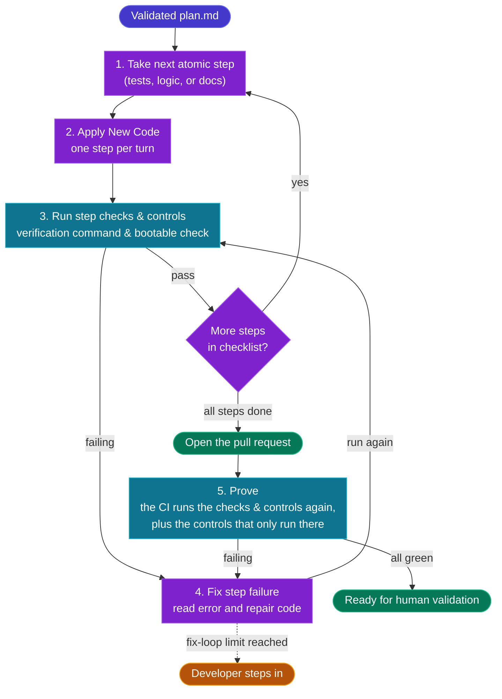

# ⚡ 4 — Code

  STAGE 4
  Fast autonomous loops, generate, test &amp; fix until green

Where specifications and plans become executable software. In the Agentic Software Factory, **developers do not code manually**: AI agents autonomously
generate the code, tests, and documentation, iterating in fast, closed loops until all checks, tests and controls are green.

## Purpose

| Input | Output | Owner |
|---|---|---|
| A work item that passed the [3 — Plan](./stage-plan) gate | A pull request with all CI checks passing | Developer (supervising autonomous AI agents) |

## The autonomous coding loop

1. **Step-by-step atomic execution.** The agent walks the validated Plan record **one step at a time**, rather than attempting to generate code, tests, and documentation all at once:
   - **Test steps first (or alongside logic):** Tests are generated directly from the acceptance criteria in the Plan record to prove the requirement before or alongside the implementation.
   - **Implementation steps:** The agent applies the step's `New Code`, binds Forge assets, and ensures the application stays bootable after every step.
   - **Documentation & contract steps:** OpenAPI schemas, README/VitePress guides, and migration cutovers are discrete checklist steps, executed and verified once the code behaves as expected.
2. **Fast autonomous verification loop.** After applying each step, the agent immediately runs the step's `Verification` command and `Bootable Check`, alongside relevant [deterministic controls](./deterministic-controls) (guards, gates, contracts). Running them locally takes seconds, not a CI round-trip. If a check fails, the agent parses the failure and repairs the step in a tightly bounded fix loop.
3. **Context & Forge.** The agent follows Persistent Context and imports the assets bound in
   Think from [the Forge](./forge).
4. **Committed work.** Once all steps in the plan are verified and green, the agent commits the branch and opens the pull request.
   The CI then runs the checks and controls again, plus the controls that only run there. If they fail, the agent fixes the code and the loop runs again. The developer steps in only when the fix-loop limit is reached.

## Non-negotiable rules

- **One step per turn.** Agents execute exactly one atomic step from the Plan checklist per turn. Generating entire applications, tests, and documentation in a single prompt is forbidden: it exhausts LLM context, introduces regressions, and prevents granular verification.
- **Developers do not write manual code.** Any attempt to manually hand-craft code in an IDE is an
  anti-pattern that bypasses Persistent Context and slows down delivery.
- **Green before PR.** An agent is never permitted to open a pull request with a failing build,
  type error, lint failure, failing test, or failing control. The agent keeps iterating until they pass, up to the fix-loop limit of 5 attempts per work item. Needing more than 3 is a warning sign that the plan was too big or too vague (see [Metrics](./metrics)).
- **Tests are generated alongside code, never retrofitted.** Tests are derived strictly from the
  acceptance criteria in the Plan record, not generated as an afterthought to fit the code.
- **Context is the steering wheel.** If an agent produces incorrect code or misunderstands a pattern,
  the Developer updates Persistent Context rather than manually fixing the code.
- **Dependencies are bounded.** Any new dependency introduced by an agent must be explicitly declared
  in the plan and evaluated against security and licensing controls.

## Branching

Short-lived feature branches created directly by agents from `main` or `develop`, merged through pull requests.
Long-running branches are forbidden: they create merge conflicts that break agentic context.

## Where AI is used

| Task | AI role | Human role |
|---|---|---|
| Domain logic and application services | Generate from the Plan record | Validate fidelity to the Plan acceptance criteria |
| Scaffolding, boilerplate, wiring | Generate from Forge templates | None |
| Unit, integration, and contract tests | Generate alongside the code, from the acceptance criteria | Verify tests derive from the acceptance criteria |
| API clients, data models, mappers, migrations | Generate against Forge contracts | Ensure backwards compatibility constraints are met |
| Architectural refactoring within patterns | Refactor inside the recorded boundaries | Confirm system boundaries |
| Documentation, OpenAPI specs, runbooks | Generate | Review for clarity |
| Fix loops on failing builds, type errors, lint failures, and tests | Parse the failure and repair | Intervene only if the agent reaches its limit |

## Primitives in Persistent Context

Code runs on Persistent Context primitives published by [coding-pal](https://alten-group.github.io/coding-pal/):

### Execution & Lifecycle Primitives
- A **Code Agent** implements the validated Plan one step per turn: applies `New Code`, runs verification commands, and auto-repairs failing checks.
- A **code-loop** instruction enforces coding discipline: no hand-crafted code, 1 step per turn, green before PR, short-lived branches, bounded dependencies, and a strict fix-loop limit of 5.
- A **code-loop** skill tracks step progress in `progress.json`, verifies branch lifespan, and halts execution when fix loops exceed thresholds so a developer can intervene.
- A **pr-record** skill formats and validates the pull request record: links to the backlog issue and Plan, criteria traceability, declared dependencies, and blast radius.

### Tech Stack, Testing & Documentation Instructions
When the agent touches specific application layers, scoped instructions in Persistent Context automatically steer patterns and conventions:
- **Backend & APIs**: `node-express.instructions.md` (layered architecture, error envelopes, security middleware) and `node-api-tests.instructions.md` (Supertest endpoint contracts).
- **Frontend**: `angular-admin.instructions.md` (feature slices, signals, PrimeNG components) and `angular-unit-tests.instructions.md` / `angular-e2e-tests.instructions.md` (Vitest unit and Playwright end-to-end tests).
- **Database & Persistence**: `postgres-liquibase.instructions.md` (audited changeSets, history triggers, rollbacks) and `postgres-liquibase-tests.instructions.md` (deterministic SQL migration assertions).
- **Infrastructure & Containerization**: `docker.instructions.md` (multi-stage Compose stacks, BuildKit secret mounts, non-root users).
- **Documentation & Sites**: `vitepress-docs.instructions.md` (VitePress technical guides, Mermaid diagrams, Traefik `/docs` routing) and `migration-docs.instructions.md` (structured migration records, cutover runbooks, zero-secret documentation).
- **Quality & Remediation Baseline**: `sharp-agent.instructions.md` (universal surgical diffs, zero token waste, simplicity first).

### Inputs & Assets
- The **Plan record** (`plan.md`) and bound **Forge assets** (`forge/<id>@<version>`) are the immediate inputs that steer the agent's code generation.

See the [coding-pal Code guide](https://alten-group.github.io/coding-pal/guide/domain-code) and [Tech Stacks guide](https://alten-group.github.io/coding-pal/guide/domain-stacks).

## Exit gate

A pull request leaves Code and enters [Prove](./stage-prove) when:

1. the agent has generated code, tests, and documentation from the validated Plan, using bound Forge assets where applicable and following the instructions and constraints in Persistent Context,
2. all acceptance criteria from the Plan record have corresponding automated tests,
3. the build, type check, linter, generated tests, and deterministic controls all pass with zero errors,
4. the pull request links to the backlog issue and the Plan.
