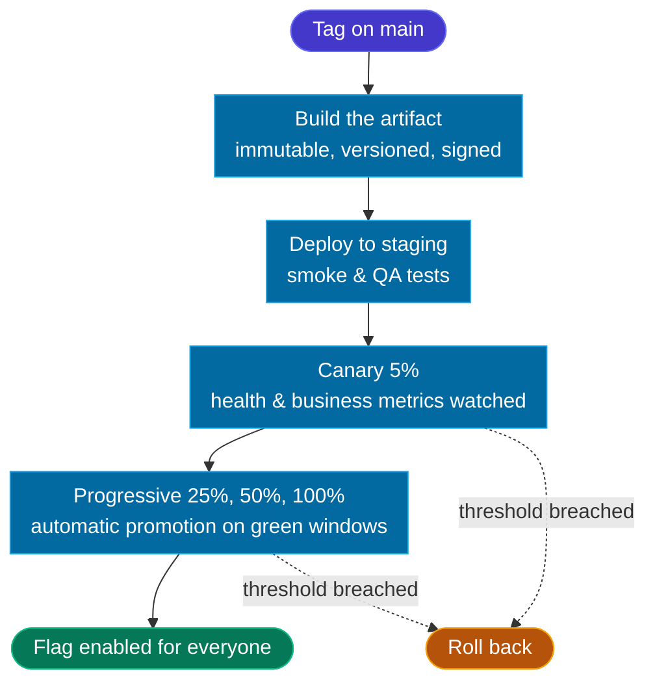

# 🚀 6 — Release

  STAGE 6
  Automated deployment, reversible at any step

Release delivers a change after Prove passes. Deploy automatically to staging, then gradually to production.

**Deploy** puts code in production, switched off. **Release** enables it for users, gradually. Plan recovery before rollout.

## Purpose

| Input | Output | Owner |
|---|---|---|
| A change that passed [5 — Prove](./stage-prove) | Value in production, observable and reversible | DevOps |

## Model

- Trunk-based: a tag on `main` is the release trigger.
- Every release produces an immutable, versioned artifact.
- Deploy is automatic to `staging`, then progressive to `production`.
- The `enable` feature flag lets you deploy code before releasing it to users.
- Every release uses the outcome metric already committed in the [1 — Triage](./stage-triage) backlog issue. [7 — Learn](./stage-learn) takes over and checks it once the rollout completes.

The `enable` feature flag is the actual release decision. Everything before it is deployment. The rollback paths are in the [Rollback](#rollback) section below.

## Rollout rules

Deployment tooling applies fixed rules at each step. AI does not decide when to promote or roll back.

| Rule | What it checks | Effect |
|---|---|---|
| **Promotion** | Health and business metrics stay inside their thresholds for the whole watch window | The rollout advances to the next step automatically |
| **Health check** | Smoke and QA tests in staging, then error rate, latency, and saturation at each step in production | A failing check halts the rollout |
| **Rollback threshold** | A limit declared per change before deployment | Crossing it triggers rollback automatically |

Watching for problems after the release belongs to [7 — Learn](./stage-learn).

## Rollback

| Mechanism | Time to effect | Used for |
|---|---|---|
| Feature flag off | Seconds | Behavior regressions |
| Traffic shift back to previous version | < 1 minute | Deployment-level failures |
| Redeploy previous artifact | Minutes | Config or runtime issues |
| Forward fix | Hours | Data-affecting issues where rollback is unsafe |

Every change with a **High** or **Critical** blast radius has its rollback mechanism named in the
[Think record](./stage-think#the-think-record) and validated in [5 — Prove](./stage-prove) before it is deployed. A change with no rollback path is not deployed.

## Where AI is used

AI prepares versions, release records, notes, and changelogs. Controls authorize publication; deployment tooling decides promote, hold, or rollback. People handle unresolved failures, not routine sign-off.

## Agents and skills {#primitives-in-persistent-context}

Release separates declaration from execution, running on primitives published by [coding-pal](https://alten-group.github.io/coding-pal/):

### Declaration & Planning Primitives
- A **Release Planner** agent synthesizes the blast radius and rollback from `think.md`, the file scope from `plan.md`, and the outcome metric from `triage.md` into the `release.md` declaration.
- A **release** instruction enforces release standards: deploy is not release, feature flags control exposure, releases stay tightly scoped, artifacts are immutable, and automated authorization is recorded before tagging.

### Deterministic Gate & Rollout Skills
- A **release-plan validator** (`validate-release.mjs`) checks the risk tier, rollout percentages, health thresholds, and rollback mechanism.
- A **release-plan evaluator** (`evaluate-rollout.mjs`) uses live metrics to return **promote**, **hold**, or **rollback**.

### Pipeline Infrastructure & Records
- The **Release record** (`specs/issue-<n>/release.md`) defines the rollout stages, watch windows, thresholds, and Learn outcome metric.
- A **release workflow template** provides the CI/CD progressive rollout skeleton (artifact tagging, staging smoke check, canary steps, and automated rollback execution), adapted to the team's platform.

See the [coding-pal Release guide](https://alten-group.github.io/coding-pal/guide/domain-release).

## Publication and deployment pipelines

Publication and deployment use the revision and evidence from [Prove](./stage-prove#delivery-pipeline), on any CI/CD platform. Apply the [shared status rules](./platform-rails#triggers-checkpoints-and-status). Publishing a package or docs does not mean the production rollout is complete.

### Publish a package or artifact

A publication pipeline distributes a prepared, versioned package, container image, or other release artifact:

1. Checks the revision, version, tag, and validation evidence.
2. Builds and tests the artifact, or verifies an existing immutable build.
3. Checks docs, metadata, contents, and provenance.
4. Selects the registry and channel; runs a dry run where supported.
5. Publishes unless in verification-only mode, confirms availability, and notifies consumers.

**Stops at:** dry run, confirmed publication, requested pause, or failure. This pipeline does not implement or merge changes.

**Passing validation does not mean published.** Record the version and registry result before setting Done if publication is required. Then [resume dependent work](./stage-think#resume-after-an-upstream-delivery).

### Deploy documentation

A documentation pipeline builds and deploys the site associated with the delivered revision:

1. Restores the delivered revision and builds any code needed by the documentation.
2. Installs site dependencies and builds and validates the documentation.
3. Stores the generated site as a versioned deployment artifact.
4. Deploys automatically to the configured hosting target after environment controls pass, then verifies availability.

**Stopping point:** a verified documentation deployment, an explicitly requested pause, or a failed build/deployment. This is separate from change validation and package publication; the delivery policy determines its trigger and whether its result is required for completion.

## Exit gate

A release is complete when the rollout has reached 100%, the watch window has passed without
threshold breach, and the observability dashboard for the change is live in [Learn](./stage-learn).
